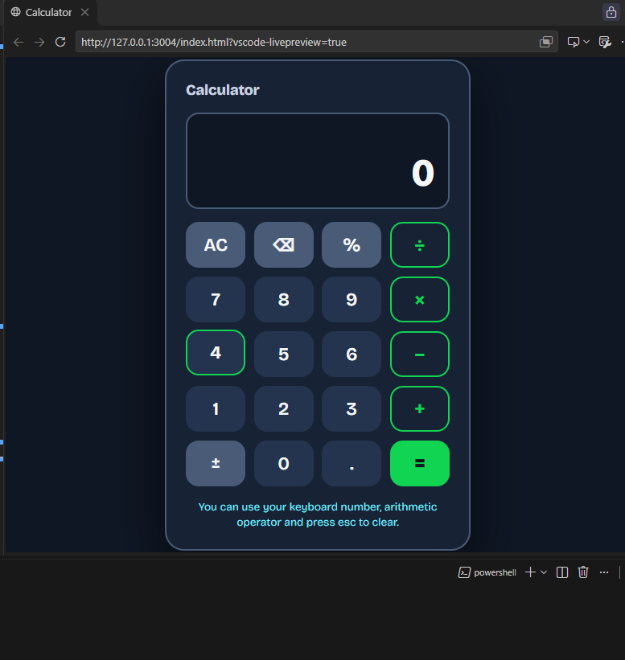

# codealpha_task2
# Calculator

A basic calculator I built with plain HTML, CSS and JavaScript. No libraries, no frameworks, just three files.

It does the four main operations (+, −, ×, ÷), shows the result live on the screen, and works with both the mouse and the keyboard.

## What it does

- Addition, subtraction, multiplication and division
- Display screen with two lines: the small one shows the expression (like `12 + 5 =`), the big one shows the number or result
- Result updates live as you type, so `5 + 5 +` already shows `10`
- `AC` clears everything, `⌫` deletes the last digit
- `%` and `±` buttons
- Full keyboard support (see the table below)
- Dark, high-contrast design with a yellow accent, so it's easy to read
- Responsive, works on phones and big screens
- Thousands separators, so `1234567` shows as `1,234,567`
- Long numbers shrink to fit the screen instead of overflowing

## Good to know

- It works **left to right**, like a basic pocket calculator. So `2 + 3 × 4` gives `20`, not `14`. Proper order of operations (BODMAS) would need an expression parser, which is beyond a basic calculator.
- `%` works like a phone calculator. On its own, `50 %` gives `0.5`. After `+` or `−` it takes the percentage of the first number, so `200 + 10 %` becomes `200 + 20` and gives `220`.

## Testing

I tested the calculator logic with many test cases, covering:

- all four operations
- floating point rounding
- divide by zero and recovering from it
- chaining and swapping operators
- decimals, backspace, `±` and `%`
- thousands separators, the digit limit and exponent results
- keyboard input and ignored shortcuts

## Task checklist

Built for the CodeAlpha front-end task "Build a Calculator".

- [x] Basic calculator using HTML, CSS and JavaScript
- [x] All arithmetic operations: +, −, ×, ÷
- [x] Interface with buttons and a display screen
- [x] Handles user input
- [x] Clearing the screen
- [x] Real-time result display
- [x] Bonus: keyboard support
- [x] Bonus: styling enhancements

## Ideas for later

- A history list of past calculations
- Proper order of operations (BODMAS)
- Square root, powers and other scientific buttons
- A light theme toggle